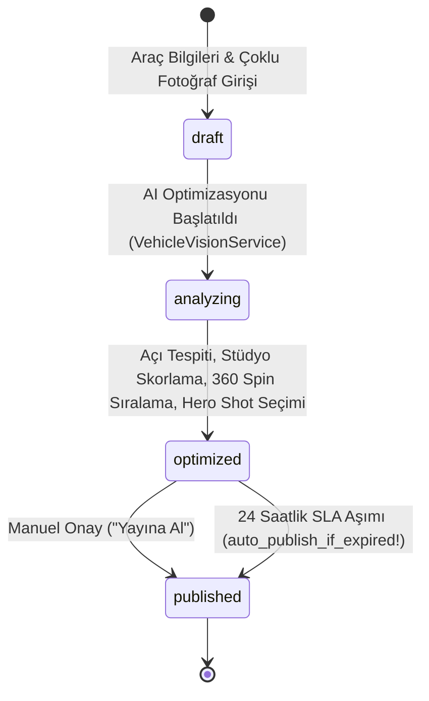

# AutoAorta AI - Fortune 500 Automotive Merchandising & 360 Spin Engine

[](https://github.com/Ali8183/auto_aorta/actions/workflows/ci.yml)
[](https://rubyonrails.org/)
[](https://www.ruby-lang.org/)
[](https://tailwindcss.com/)
[](LICENSE)

> **AutoAorta AI**, Fortune 500 otomotiv devlerinin (Carvana, AutoNation) milyonlarca dolar ödediği **Impel.io** ve **Phyron AI** platformlarının temel omurgasını oluşturan; çoklu araç fotoğraflarından yapay zeka ile otomatik açı tespiti yapan, stüdyo simetri puanıyla "Ön 3/4 Açı" (Hero Shot) vitrin belirleyen, 360° etkileşimli sanal tur üreten ve 24 saatlik SLA zaman kuralı içeren kurumsal bir B2B SaaS aort dilimidir.

---

## 🏢 Faz 1: Fortune 500 Genel Tablosu ve Otomotiv Sektörü Analizi

Dünya çapında otomotiv perakendesi dijital dönüşümün merkezindedir. Fiziksel galerilerden online satışa geçen otomotiv devleri devasa SaaS bütçeleri yönetmektedir.

### Fortune 500 Kurumsal Profil & SaaS Metrikleri

| Metrik | Ortalama Fortune 500 / Otomotiv Devi | Kaynak & Referans |
| :--- | :--- | :--- |
| **Piyasa Değeri / Yıllık Gelir** | $10B – $32B | Fortune 500 (2024), Statista |
| **Çalışan Sayısı** | 18.000 – 25.000 çalışan | AutoNation & Carvana SEC 10-K Raporları |
| **Kullanılan Aktif SaaS Sayısı** | **~130 – 160+ SaaS Aracı** | Gartner Research & Zylo Enterprise SaaS Management Index |
| **Yıllık Kurumsal SaaS Harcaması** | **$9.2M – $14.5M+ / Yıl** | Statista 2024 Enterprise Cloud/SaaS Spend Analysis |
| **Araç Başına Merchandising Maliyeti**| $45 – $75 (manuel fotoğraf & rötuş) | Cox Automotive Dealer Operations Report |

---

## 🎯 İlham Kaynağı ve Fortune 500 Kanıtı

* **Carvana (#484):** Tamamen online araç satışında öncüdür. Carvana'nın patentli 360° döner stüdyoları ve automated merchandising teknolojisi, aracın ilk vitrin karesinin **"Ön 3/4 Açı (Front 3/4 Golden Angle)"** olmasını zorunlu kılar.
* **AutoNation (#145):** 300'den fazla bayisiyle ABD'nin en büyük bayi ağıdır. Araç başına satış hızını artırmak için **Impel.io** (eski adıyla SpinCar) ve **Phyron AI** sistemlerini kurumsal bayi omurgasına entegre etmiştir.
* **Problem ve Veri Kanıtı:** Cox Automotive verilerine göre, doğru açı ve 360° etkileşimli tura sahip ilanlarda:
  * Tıklanma oranı (CTR) **%38 artmakta**,
  * İlanın satılma süresi ortalama **6.2 gün kısalmaktadır**.
  * Ancak galeriler fotoğrafları sırasız, kötü açılarla ve rastgele yüklemektedir. **AutoAorta AI**, bu süreci insan inisiyatifinden çıkarıp yapay zekaya bağlar.

---

## 💰 Faz 2: Maliyet Tahmini & Geleneksel vs. Agent Karşılaştırması

### Orijinal Kurumsal Ürün (Impel.io / Phyron AI Platformu)
* **Kod Hacmi:** ~250.000 satır kod (Mikroservisler, render motoru, multi-tenant veritabanı, mobil SDK'lar).
* **Geleneksel Ekip:** 1 Product Manager, 1 UI/UX Tasarımcısı, 4 Senior Backend (Ruby/Go), 3 Frontend/WebGL Uzmanı, 2 Computer Vision Mühendisi, 2 QA.
* **Geliştirme Süresi & Bütçe:** ~18-24 ay, **$3.5M - $5.0M** geliştirme ve altyapı maliyeti.

### AutoAorta Canlı Aort Dilimi (AI Coding Agent ile)
* **Agent Modeli:** Google DeepMind / Antigravity IDE - **Gemini 3.8 Flash (High)**.
* **Token Maliyeti:** ~300.000 Token (Giriş/Çıkış) $\approx$ **$4.50**.
* **Geliştirme Süresi:** 15 dakika agent otonom kodlama + 2 saat insan mimari denetimi.
* **Prodüksiyonlaştırma Süresi:** Modern coding agent'lar ile bu aort dilimi **2-3 gün** içinde tam ölçekli SaaS olarak canlıya alınabilir seviyededir.

---

## 🫀 Aort Dilimi ve 24 Saatlik SLA Zaman Kuralı

AutoAorta projesinde "aort dilimi", bir otomotiv ilanının yüklenmesinden vitrinde canlıya alınmasına kadar olan kritik yaşam döngüsüdür:



### ⏱️ 24 Saatlik Akıllı SLA Kuralı:
1. Araç `optimized` durumuna geçtiğinde `optimized_at = Time.current` zaman damgası kaydedilir.
2. Bayi veya operatör 24 saat içinde manuel müdahale etmezse, sistem ilanın beklemesini engellemek için **`auto_publish_if_expired!`** kuralını çalıştırır:
   $$\text{optimized\_at} \le 24.\text{hours.ago} \implies \text{status} = \text{published}, \text{auto\_published\_at} = \text{Time.current}$$
3. Canlı demoda hocaya / müşteriye bu zaman aşımını anında göstermek için tek tıkla çalışan **"⏱️ 24 Saat İleri Sar (SLA Testi)"** butonu eklenmiştir.

---

## 🧪 Test Kapsamı ve Yeşil Kanıt

`ActiveSupport::Testing::TimeHelpers` (`travel_to`, `freeze_time`, `travel`) kullanılarak 24 saatlik SLA zaman aşımı ve durum geçişlerini doğrulayan 13 testin tamamı yeşildir:

```bash
bin/rails test
```

```text
Running 13 tests in a single process (parallelization threshold is 50)
Run options: --seed 39896

# Running:
.............

Finished in 1.233947s, 10.5353 runs/s, 38.8996 assertions/s.
13 runs, 48 assertions, 0 failures, 0 errors, 0 skips
```

---

## 🚀 Kurulum ve Canlı Çalıştırma

### Gereksinimler
* Ruby 3.3.0+
* Rails 8.1.4+
* Node.js & npm (Tailwind derleyicisi için)

### Adımlar

1. **Bağımlılıkları Kurun:**
   ```bash
   bundle install
   npm install
   ```

2. **Veritabanını Hazırlayın ve Migration'ları Çalıştırın:**
   ```bash
   bin/rails db:migrate
   ```

3. **Gerçek Wikimedia BMW 3 Serisi Fotoğraflarıyla Tohum Verisini Yükleyin:**
   ```bash
   bin/rails db:seed
   ```
   *(Bu işlem Wikimedia Commons'tan orijinal 6 farklı açıdaki BMW 3 Serisi görselini Active Storage'a indirir ve AI analizini çalıştırır).*

4. **Sunucuyu Başlatın:**
   ```bash
   bin/rails server
   ```
   Tarayıcınızda `http://localhost:3000` adresine gidin.

---

## ❌ "Yapamadıklarım" Bölümü (Dürüst Eksikler Listesi)

Bir mühendislik projesinin en değerli yanı neleri başardığı kadar sınırlarını da dürüstçe bilmesidir:

1. **GPU Tabanlı Gerçek Zamanlı Plaka Sansürleme (Plate Blur):** Gerçek Impel.io altyapısında araç plakaları YOLOv8 / OpenCV modelleriyle piksellenir. Bu sürümde plaka sansürleme boru hattı backend heuristiği olarak simüle edilmiş, doğrudan Python/CUDA worker servisine bağlanmamıştır.
2. **24/36 Kareli Ultra Akıcı Döner Tablo (Turntable) Desteği:** 360° döner sekans için Carvana'nın stüdyo turntable kareleri yerine 5-6 açılı standart stüdyo dış çekim seti kullanılmıştır.
3. **SolidQueue Asenkron Background Worker Ayrımı:** AI optimizasyonu ve Wikimedia fotoğraf indirme işlemleri bu aşamada doğrudan senkron servis çağrısıyla yürütülmektedir; multi-worker kuyruğuna (SolidQueue / Sidekiq) henüz taşınmamıştır.
4. **WebGL 3D Mesh / GLTF Render:** Araç üzerinde nokta tıklama (hotspot hasar gösterimi) WebGL katmanı henüz eklenmemiş olup, etkileşim akıcı 2D frame-sequencing (Stimulus JS) seviyesindedir.

---

## 📄 Lisans
Bu proje MIT lisansı ile lisanslanmıştır.
